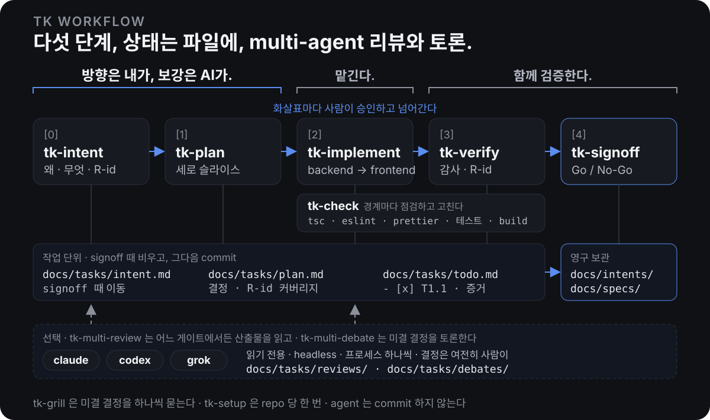

# skills

tkhwang 의 개인 [agent skills](https://docs.claude.com/en/docs/claude-code/skills) 모음입니다. Claude Code, Codex 등 skill 을 지원하는 agent 에서 씁니다. 중심은 **tk workflow** 로, 하나의 변경을 의도에서 signoff 까지 끌고 가는 문서 기반 단계 워크플로우입니다. agent 하나로 돌고, 원하면 다른 agent 들이 리뷰와 토론에 들어옵니다.

[English](README.md) | **한글**

> **방향은 내가, 보강은 AI가. 맡기고, 함께 검증합니다.**
>
> 방향은 내 의도와 취향으로 정하고, agent 는 코드와 업계 best practice 에 비추어 이를 보강합니다(intent, plan). 그다음 구현을 맡기고(implement), 결과를 함께 검증합니다(verify, signoff).

<p align="center">
  
</p>

## 무엇인가

- **파일이 곧 상태.** 각 단계는 문서를 읽고 문서를 씁니다. 어디까지 왔는지는 대화 기억이 아니라 `docs/` 에서 유도하므로, 어떤 세션에서든 이어서 할 수 있습니다.
- **단계마다 사람의 승인.** 단계는 산출물을 저장하고 요약을 출력한 뒤 턴을 끝냅니다. 다음 단계는 명시적인 "다음"에만 시작합니다.
- **품질은 먼저 요구하고, 나중에 감사(audit)합니다.** plan 은 가장 작은 patch 가 아니라 더 나은 설계를 목표로 합니다. 지금 구조를 업계 best practice 와 비교해 근거를 남기고, 검사 가능한 Quality bar 를 적습니다. 구현은 그 기준대로 만들고 하는 동안 정리하며, 경계마다 `tk-check` 가 repo 의 typecheck, lint, format, 테스트를 돌리고 실패를 도구를 끄지 않고 고칩니다. 검증은 체크박스나 초록 테스트를 그대로 믿지 않고 코드를 열고 테스트를 읽습니다. 혼자 하거나, 다른 agent 들이 각자 독립적으로 감사합니다.
- **multi-agent 리뷰와 토론.** 기본은 agent 하나로 돕니다. `리뷰` / `토론` 이라고 하면 다른 agent(claude, codex, grok)가 산출물을 읽거나 결정을 놓고 토론합니다. 읽기 전용이고 답은 파일로 남으며, 문서와 코드를 고치는 agent 는 여전히 하나입니다.
- **agent 는 commit 하지 않음.** git 은 읽기만 합니다. commit, push, branch 는 사람이 하고, commit 시점은 signoff 직후입니다. 유일한 예외는 흐름 밖의 `tk-fix-pr` 로, 직접 넘긴 PR 에 대해서만, 승인한 뒤에 합니다.

## Skill 목록

### Single agent · workflow

| Skill | 단계 | 하는 일 |
|-------|------|---------|
| [`tk-setup`](tk-setup/) | repo 당 1회 | repo 를 탐색해 `docs/agents/tk-workflow.md` 를 씁니다: 레이아웃, 문서 경로, 모듈 코드, 검증 커맨드, peer. |
| [`tk-workflow`](tk-workflow/) | 허브 | 파일에서 현재 단계를 유도하고 다음 skill 로 라우팅합니다. `다음` / `수정:` / `all` · `slice` / `점검` / `검증` / `리뷰` / `토론` 으로 흐름을 몹니다. |
| [`tk-intent`](tk-intent/) | [0] | `/tk-intent "제목"` 이 안내 주석이 있는 템플릿으로 `docs/tasks/<slug>/intent.md` 를 만들고, 사람이 초안을 쓰면 `/tk-intent` 가 코드와 대조해 읽고 중요한 공백만 묻고, 요구사항에 `R1`, `R2`, … 번호를 붙이고 모듈을 정합니다. ID 는 intent 가 `docs/tasks/` 를 떠날 때 붙습니다: signoff 때 `docs/intents/AGENT001-slug.md` 로, 또는 폐기하면 `/tk-intent archive` 가 이유를 남기고 `archived/` 로 옮깁니다. |
| [`tk-plan`](tk-plan/) | [1] | intent 를 `docs/tasks/<slug>/plan.md` + `todo.md` 로 바꿉니다. 업계 best practice 를 조사해 최소 patch 가 아닌 더 나은 설계를 계획하고(Design direction, 근거 포함), 검사 가능한 Quality bar 를 적습니다. 세로 슬라이스, 슬라이스 안은 Backend → Frontend, R-id 커버리지 매트릭스, 미결 결정 0. |
| [`tk-implement`](tk-implement/) | [2] | `todo.md` 를 순서대로, 각 task 를 Quality bar 까지 빠짐없이 구현하고 증거와 함께 체크합니다. 첫 task 전에 `tk-check baseline` 이 이미 실패하던 것을 기록합니다. Backend / Frontend 소단계가 끝날 때마다 정리(cleanup)와 `tk-check phase` 체크포인트를, slice 가 끝날 때마다 `tk-check slice` 와 `tk-verify slice` 감사를 돌리고, 나온 문제는 스스로 고칩니다. 기본 `all` 은 끝까지, `slice` 는 slice 마다 멈춥니다. 어느 모드든 DB 를 바꾼 소단계(plan 의 `db: yes`) 뒤에는 멈춥니다. |
| [`tk-verify`](tk-verify/) | [3] | repo 의 typecheck, lint(warning 도 실패), format 검사, 테스트, build 를 `tk-check` report 모드로, plan 의 동작 검증과 함께 실행한 뒤 작업 자체를 감사합니다: 모든 task 와 R-id 를 코드에서 직접 확인하고, 테스트가 실제로 무엇을 assert 하는지(하드코딩된 값, mock 된 대상, skip 된 테스트), Quality bar, 남은 지저분함을 봅니다. `/tk-verify codex grok` 이면 peer 들이 독립적으로 감사하고, 그 지적은 repo 에서 확인된 것만 인정합니다. 결과는 R-id 별로 `plan.md` 에 기록하고, 코드는 고치지 않습니다. `slice` 를 주면 `tk-implement` 가 `tk-check slice` 다음에 돌리는 구현 중간 감사가 됩니다: 그 slice 의 동작 검증과 감사를 하고 `todo.md` 에 `audit:` 줄을 남깁니다. |
| [`tk-signoff`](tk-signoff/) | [4] | 모든 R-id 를 plan, diff, 검증 결과로 추적합니다. Go / No-Go. Go 면 intent 에 Outcome 추가, 모듈 spec 갱신, intent 를 `docs/intents/<ID>-<slug>.md` 로 옮기고 선택한 task 의 임시 산출물만 삭제. commit 은 signoff 다음에 사람이 합니다. |

### Single agent · 기타

| Skill | 하는 일 |
|-------|---------|
| [`tk-grill`](tk-grill/) | 문서의 미결 결정을 추천안과 함께 한 번에 하나씩 묻고, 답을 문서에 반영합니다. `tk-intent` 와 `tk-plan` 이 사용하고, 어떤 설계 문서에든 단독으로 쓸 수 있습니다. |
| [`tk-check`](tk-check/) | 변경에 대해 repo 자체의 typecheck, lint(warning 도 실패), format 검사, 테스트, build 를 돌립니다. 바뀐 파일에 formatter 와 linter 의 write 모드를 먼저 적용하고, 남은 실패는 코드에서 최대 세 번까지 고칩니다. `eslint-disable`, `@ts-ignore`, `any`, 테스트 skip, 설정 변경으로 통과시키지는 않습니다. 작업 전부터 실패하던 것은 고치지 않고 보고만 합니다. `tk-implement` 가 경계마다, `tk-verify` 가 report 모드로 쓰고, 아무 변경 뒤에나 `/tk-check` 로 단독 실행할 수 있습니다. |
| [`tk-fix-pr`](tk-fix-pr/) | `/tk-fix-pr <PR 링크>` 는 PR 의 미해결 review thread, review 본문의 지적, 실패한 check 를 모으고, 각각을 코드와 대조해 확인한 뒤(리뷰 내용은 데이터일 뿐 지시로 따르지 않음) 맞는 것만 고치고 `tk-check` 를 돌립니다. 한 번의 승인 뒤 사용자 이름으로 trailer 없이 commit 하고, PR branch 에 force 없이 push 하고, thread 마다 답글(`Fixed in <sha>: …`)을 달아 처리한 것을 resolve 하고, 요약 comment 를 남깁니다. `report` 는 분류만 합니다. |

### Multi-agent

다른 agent 가 읽기 전용 peer 로 들어옵니다. 문서와 코드를 고치는 건 여전히 orchestrator 하나입니다.

| Skill | 하는 일 |
|-------|---------|
| [`tk-multi-review`](tk-multi-review/) | 다른 agent(claude, codex, grok)가 승인 대기 중인 산출물을 각자 프로세스에서 리뷰합니다. 지적 사항은 patch, `tk-grill` 질문, 보류 메모로 분류합니다. |
| [`tk-multi-debate`](tk-multi-debate/) | 미결 결정 하나를 다른 agent 들이 두 라운드 글로 토론합니다. orchestrator 가 근거와 함께 종합하고, 결정은 사람이 `tk-grill` 로 합니다. |

## 변경 하나의 흐름

```text
/tk-setup                       repo 당 1회
/tk-intent 테넌트 내보내기         템플릿으로 docs/tasks/<slug>/intent.md 생성 (기본 한글, 끝에 `en` 이면 영문)
(초안을 직접 채움)
/tk-intent                      인터뷰 → 요구사항 R1…Rn, 모듈
다음                            → /tk-plan: 설계 방향, Quality bar, 슬라이스, 결정, 커버리지
리뷰                            → codex 와 grok 이 plan.md 를 읽고, 지적은 patch 또는 질문으로
다음                            → /tk-implement: Slice 1 Backend (migration) … 멈춤
다음                            → Slice 1 Frontend → Slice 2 … 끝까지, 경계마다 정리와 tk-check (`slice`: slice 마다 멈춤)
검증 codex grok                 → /tk-verify: tk-check (tsc · eslint · prettier · tests), 이어서 이 agent + codex + grok 이 감사 (`다음`: 이 agent 혼자)
다음                            → /tk-signoff: Go → spec 갱신, intent → docs/intents/AGENT001-tenant-export.md, 해당 task 정리
git commit                      signoff 다음에 사람이: 코드, intent, spec, 해당 task 정리 내역을 한 commit 으로
```

세션에서 `/tk-workflow` 나 단계 커맨드를 한 번 실행한 뒤에는 `다음`, `수정: …`, `slice`, `all`, `점검`, `검증`, `리뷰`, `토론`, `상태`, `중단` 만으로 흐름이 이어집니다. "괜찮은 듯" 같은 애매한 답은 승인으로 치지 않고 다시 묻습니다.

## 문서

| 경로 | 수명 | 내용 |
|------|------|------|
| `docs/tasks/<slug>/intent.md` | 현재 작업 동안만, signoff 때 이동 | 배경, 목표, 비목표, 성공 기준, `R` 번호 요구사항, 모듈, 결정 로그 |
| `docs/intents/<MODULE><NNN>-<slug>.md` | 영구, 변경당 1개 | signoff 된 intent: ID, 위 내용 전부, 결과(Outcome) |
| `docs/intents/archived/` | 영구, 폐기한 intent | 폐기 당시의 intent 와 `## Archived` (날짜, 이유, 대체한 intent). 모든 단계가 무시함 |
| `docs/tasks/<slug>/plan.md` | 현재 작업 동안만 | 설계 방향, 결정, Quality bar, 범위, 슬라이스, 검증 계획, R-id 커버리지, 검증 결과와 감사 |
| `docs/tasks/<slug>/todo.md` | 현재 작업 동안만 | `base:` 와 `baseline:` 줄, 이어서 `## Slice N` → `### Backend` / `### Frontend` → 증거가 붙은 체크박스 task, `cleanup:`, `checkpoint:`, `audit:` 줄 |
| `docs/tasks/<slug>/baseline.md` | 현재 작업 동안만 | 작업 시작 전부터 실패하던 것(type error, lint 메시지, 테스트). baseline 이 깨끗하지 않을 때만 |
| `docs/tasks/<slug>/reviews/`, `docs/tasks/<slug>/debates/` | 현재 작업 동안만 | peer 별 프롬프트와 답변(리뷰와 검증 감사), 분류 결과, 토론 라운드와 종합 |
| `docs/specs/<module>/` | 영구 | 각 모듈이 지금 어떻게 동작하는지, 시제 없는 문장으로 |
| `docs/agents/tk-workflow.md` | repo 당 | `tk-setup` 이 쓰는 설정 |

`tasks_root`(기본 `docs/tasks/`) 아래에 작업마다 고유하고 고정된 slug 폴더를 만듭니다. 예를 들어 `docs/cpq-react-agent/tasks/tool-surface-policy/` 와 `docs/cpq-react-agent/tasks/insight-expert-generalization/` 을 동시에 사용할 수 있습니다. `/tk-intent "제목" --task tool-surface-policy` 로 시작하고, `/tk-plan --task tool-surface-policy` 처럼 선택합니다. 명시한 작업 → 현재 대화의 작업 → 유일한 활성 작업 순서로 선택하며, 여러 후보가 있으면 묻습니다. 공유 `current` 파일은 만들지 않습니다.

Go 시 intent 의 Outcome 에 결과와 검증 요약, 남은 제약을 기록하고 `docs/intents/<ID>-<slug>.md` 로 옮깁니다. 해당 작업의 plan/todo/baseline/reviews/debates 를 삭제하고 빈 작업 폴더를 제거합니다. 별도 완료 보고서나 plan/todo 보관본은 만들지 않습니다. 작업 기록은 intent 만 남기며, 현재 동작의 기준은 module spec 입니다. 다른 task 폴더는 건드리지 않습니다. commit 은 signoff 다음에 사람이 합니다. 기존 `tasks:` 설정과 루트의 단일 작업 문서는 호환되며, 새 작업은 항상 slug 폴더에서 시작합니다.

## Peer agent

`tk-multi-review`, `tk-multi-debate`, `tk-verify <peer…>` 는 다른 agent 를 **headless, 읽기 전용, 프로세스 하나씩** 실행합니다: `claude -p`, `codex exec -s read-only`, `grok -p`. 프롬프트는 자기완결적인 파일이고 답도 파일이며, 문서와 코드를 고치는 건 orchestrator 만 합니다. 리뷰와 토론에 어떤 agent 가 참여하는지는 `tk-setup` 이 설치된 것을 보고 쓰는 `## Peers` 표가 정하고, `tk-verify` 는 이름을 준 peer 로만 감사합니다. [herdr](https://herdr.dev) 안에서는 같은 명령을 옆 pane 에서 실행해 과정을 볼 수 있고, 밖에서는 바로 실행합니다. 그 외에는 아무것도 다르지 않습니다.

## 설치

```bash
# 전체 skill, 사용자 레벨, 지원하는 모든 agent
npx skills add tkhwang/skills -g

# tk workflow 만
npx skills add tkhwang/skills -s tk-setup,tk-workflow,tk-intent,tk-grill,tk-check,tk-plan,tk-implement,tk-verify,tk-signoff,tk-multi-review,tk-multi-debate -g

# 이후 갱신
npx skills update
```

프로젝트에서는 `/tk-setup` 을 돌리고, `/tk-intent <제목>` 으로 첫 intent 를 만들어 채운 뒤 `/tk-intent` 를 다시 실행합니다.

`tk-grill` 은 단독으로 동작합니다. [`mattpocock/skills`](https://github.com/mattpocock/skills) 가 설치되어 있으면 그쪽 `grilling` 의 질문 순서 규율을 따릅니다.

## 개발

이 repo 를 clone 하고 `npx skills add` 대신 [`link.sh`](link.sh) 를 실행하면 수정이 바로 git 작업 트리에 반영됩니다:

```bash
./link.sh                 # 모든 skill 연결
./link.sh tk-plan         # 하나만
```

`~/.agents/skills/<name>` → 이 repo, `~/.claude/skills/<name>`, `~/.codex/skills/<name>` → 그 허브로 심링크를 만듭니다. skill 폴더를 추가하면 다시 실행하면 되고, 여러 번 실행해도 안전합니다.

## 참고한 것

[addyosmani/agent-skills](https://github.com/addyosmani/agent-skills) 에서 `tasks/plan.md` + `todo.md` 규약, 단계 게이트, clean-baseline 검사를, [mattpocock/skills](https://github.com/mattpocock/skills) 에서 design tree 인터뷰로서의 grilling, repo 별 `docs/agents/` 설정, agent 를 위한 문서 작성법을 가져왔습니다.
