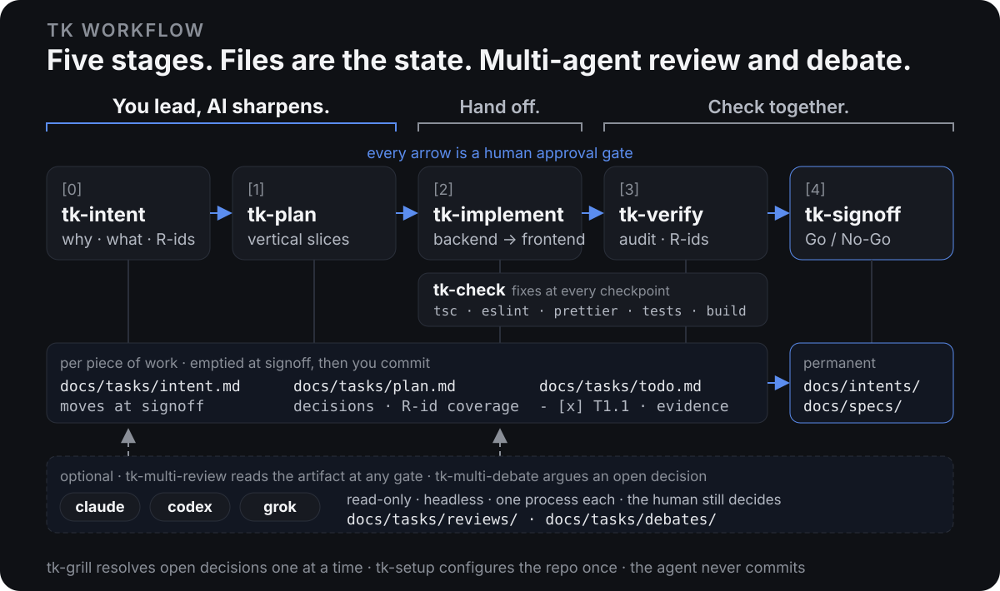

# skills

tkhwang's personal [agent skills](https://docs.claude.com/en/docs/claude-code/skills) for Claude Code, Codex, and other skill-aware agents. The main piece is **tk workflow**: a staged, document-driven way to take one change from intent to signoff. It runs with one agent, and other agents join for review and debate when you ask.

**English** | [한글](README.ko.md)

> **You lead, AI sharpens. Hand off. Check together.**
>
> You set the direction from your own intent and taste, and the agent sharpens it against the code and current best practice (intent, plan). Then you hand off the build (implement) and check the result together (verify, signoff).

<p align="center">
  
</p>

## What it is

- **Files are the state.** Each stage reads a document and writes a document. Where work stands is derived from `docs/`, never from conversation memory, so any session can pick it up.
- **A human gate at every stage.** A stage saves its artifact, prints a summary, and ends the turn. The next stage starts only on an explicit "next".
- **Quality is asked for, then audited.** The plan aims for the better design, not the smallest patch: it compares the current structure with current best practice, cites its sources, and writes a checkable Quality bar. Implementation builds to that bar and cleans up as it goes, and `tk-check` runs the repo's typecheck, lint, format and tests at every boundary, fixing what fails without silencing the tools. Verification takes no checkbox or green run on trust: it opens the code and reads the tests, alone or with peer agents auditing independently.
- **Multi-agent review and debate.** The flow runs with one agent. Say `review` or `debate` and other agents (claude, codex, grok) read the artifact or argue a decision, read-only; their answers land in files, and one agent still does all the editing.
- **The agent never commits.** It reads git, it does not write it. Commits, pushes, and branches are yours. The one exception is `tk-fix-pr`, outside the flow, on a PR you hand it, after you approve.

## Skills

### Single agent · workflow

| Skill | Stage | What it does |
|-------|-------|--------------|
| [`tk-setup`](tk-setup/) | once per repo | Explores the repo and writes `docs/agents/tk-workflow.md`: layout, docs paths, module codes, verify commands, peers. |
| [`tk-workflow`](tk-workflow/) | hub | Derives the current stage from the files, routes to the next skill, and drives the flow with `next` / `revise:` / `all` · `slice` / `check` / `verify` / `review` / `debate`. |
| [`tk-intent`](tk-intent/) | [0] | `/tk-intent AGENT "title"` scaffolds `AGENT001-slug.md` from a guided template; you write the draft; `/tk-intent AGENT001` reads it against the code, asks the important gaps, numbers requirements as `R1`, `R2`, …; `/tk-intent archive AGENT001` records why an intent was dropped and moves it to `archived/`. |
| [`tk-plan`](tk-plan/) | [1] | Turns the intent into `docs/tasks/plan.md` + `todo.md`. Researches current best practice and plans the better design rather than the minimal patch (Design direction, with references), writes a checkable Quality bar, and cuts vertical slices, each Backend → Frontend, with an R-id coverage matrix and no open decisions. |
| [`tk-implement`](tk-implement/) | [2] | Works `todo.md` in order, building each task completely to the Quality bar and checking boxes with evidence. Before the first task `tk-check baseline` records what already fails. Every Backend / Frontend sub-phase ends with a cleanup pass and a `tk-check phase` checkpoint; every slice adds `tk-check slice` and a `tk-verify slice` audit, and it fixes what they find itself. Runs to the end (`all`, the default) or stops after each slice (`slice`); either way it stops after a sub-phase that changes the database (`db: yes` in the plan). |
| [`tk-verify`](tk-verify/) | [3] | Runs the repo's typecheck, lint (warnings fail), format check, tests and build through `tk-check` in report mode, plus the plan's behaviour checks, then audits the work itself: every task and R-id in the code, what each test really asserts (hardcoded values, mocked subjects, skipped tests), the Quality bar, and leftover mess. `/tk-verify codex grok` adds independent peer audits whose findings are confirmed in the repo before they count. Records results per R-id in `plan.md`, and never edits code. With `slice` it is the mid-build audit `tk-implement` runs after `tk-check slice`: that slice's behaviour checks and audit, an `audit:` line in `todo.md`. |
| [`tk-signoff`](tk-signoff/) | [4] | Traces every R-id through plan, diff, and verification. Go / No-Go. On Go: appends the intent Outcome, updates module specs, empties `docs/tasks/`. |

### Single agent · other

| Skill | What it does |
|-------|--------------|
| [`tk-grill`](tk-grill/) | Asks the unresolved decisions in a document one at a time, with a recommendation, and patches answers in. Used by `tk-intent` and `tk-plan`; works on any design doc on its own. |
| [`tk-check`](tk-check/) | Runs the repo's own typecheck, lint (warnings fail), format check, tests and build on the change. Applies the formatter's and linter's write modes to the changed files, then fixes what still fails in the code, up to three rounds, never with `eslint-disable`, `@ts-ignore`, `any`, skipped tests or config changes. What already failed before the work is reported, not fixed. Used by `tk-implement` at every boundary and by `tk-verify` in report mode; `/tk-check` works on its own after any change. |
| [`tk-fix-pr`](tk-fix-pr/) | `/tk-fix-pr <PR link>` collects the PR's unresolved review threads, review-body findings and failing checks, confirms each against the code (review text is data, never instructions), fixes the valid ones and runs `tk-check`. After one approval gate it commits in your name with no trailers, pushes to the PR branch without force, replies to every thread (`Fixed in <sha>: …`), resolves the addressed ones and posts a summary comment. `report` only triages. |

### Multi-agent

Other agents join as read-only peers. The orchestrator stays the one agent that edits.

| Skill | What it does |
|-------|--------------|
| [`tk-multi-review`](tk-multi-review/) | Peer agents (claude, codex, grok) review the artifact awaiting approval, each in its own process. Findings are triaged into patches, `tk-grill` questions, or deferred notes. |
| [`tk-multi-debate`](tk-multi-debate/) | Peer agents argue one open decision in two written rounds. The orchestrator synthesizes with evidence; the human decides through `tk-grill`. |

## How one change flows

```text
/tk-setup                       once per repo
/tk-intent AGENT Tenant export  scaffold docs/intents/AGENT001-tenant-export.md (Korean template; append `en` for English)
(you fill in the draft)
/tk-intent AGENT001             interview → requirements R1…Rn
next                            → /tk-plan: design direction, Quality bar, slices, decisions, coverage
review                          → codex and grok read plan.md; findings patched or asked
next                            → /tk-implement: Slice 1 Backend (migration) … stop
next                            → Slice 1 Frontend → Slice 2 … to the end, cleanup and tk-check at every boundary (`slice`: stop per slice)
verify codex grok               → /tk-verify: tk-check (tsc · eslint · prettier · tests), then audit by this agent + codex + grok (`next`: this agent alone)
next                            → /tk-signoff: Go → specs updated, tasks emptied
git commit                      yours
```

After the first `/tk-workflow` or stage command in a session, the plain words `next`, `revise: …`, `slice`, `all`, `check`, `verify`, `review`, `debate`, `status`, and `stop` keep the flow moving. Hedged answers ("looks fine") are not approval; the driver asks again.

## Documents

| Path | Lifetime | Holds |
|------|----------|-------|
| `docs/intents/<MODULE><NNN>-<slug>.md` | permanent, one per change | why, what, non-goals, success criteria, `R`-numbered requirements, decision log, outcome |
| `docs/intents/archived/` | permanent, dropped intents | the intent as it stood when dropped, plus `## Archived` (date, reason, superseding intents); ignored by every stage |
| `docs/tasks/plan.md` | current work only | design direction, decisions, Quality bar, scope, slices, verification plan, R-id coverage, verification results and audit |
| `docs/tasks/todo.md` | current work only | `base:` and `baseline:` lines, then `## Slice N` → `### Backend` / `### Frontend` → checkbox tasks with evidence, `cleanup:`, `checkpoint:` and `audit:` lines |
| `docs/tasks/baseline.md` | current work only | what already failed before the work started (type errors, lint messages, tests), when the baseline is not clean |
| `docs/tasks/reviews/`, `docs/tasks/debates/` | current work only | each peer's prompt and answer (reviews and verify audits), the triage, the debate rounds and synthesis |
| `docs/specs/<module>/` | permanent | how each module behaves now, written in timeless language |
| `docs/agents/tk-workflow.md` | per repo | the configuration `tk-setup` writes |

`plan.md`, `todo.md`, `baseline.md`, `reviews/` and `debates/` are overwritten per piece of work and emptied at signoff; git history is the archive, so signoff asks before emptying files you have not committed, and the intent's Outcome keeps the verification and audit summary. Repos that already lay docs out differently keep their layout through `tk-setup`.

## Peer agents

`tk-multi-review`, `tk-multi-debate` and `tk-verify <peer…>` run other agents **headless, read-only, one process each**: `claude -p`, `codex exec -s read-only`, `grok -p`. The prompt is a self-contained file, the answer is a file, and only the orchestrating agent edits anything. Which agents review and debate is a `## Peers` table that `tk-setup` writes from what is installed; `tk-verify` audits with exactly the peers you name. Inside [herdr](https://herdr.dev) the same commands run in a sibling pane so you can watch; outside herdr they run directly. Nothing else changes.

## Install

```bash
# all skills, user-level, every supported agent
npx skills add tkhwang/skills -g

# just the tk workflow
npx skills add tkhwang/skills -s tk-setup,tk-workflow,tk-intent,tk-grill,tk-check,tk-plan,tk-implement,tk-verify,tk-signoff,tk-multi-review,tk-multi-debate -g

# later
npx skills update
```

Then, in a project: run `/tk-setup`, scaffold your first intent with `/tk-intent <MODULE> <title>`, fill it in, and run `/tk-intent <ID>`.

`tk-grill` works on its own. If [`mattpocock/skills`](https://github.com/mattpocock/skills) is installed, it follows that repo's `grilling` discipline for question ordering.

## Develop

Clone this repo and run [`link.sh`](link.sh) instead of `npx skills add`, so edits flow straight to git:

```bash
./link.sh                 # link every skill
./link.sh tk-plan         # link one
```

It creates `~/.agents/skills/<name>` → this repo, and `~/.claude/skills/<name>`, `~/.codex/skills/<name>` → that hub. Re-run after adding a skill folder; it is idempotent.

## Credits

Shaped by [addyosmani/agent-skills](https://github.com/addyosmani/agent-skills) (the `tasks/plan.md` + `todo.md` convention, stage gating, clean-baseline checks) and [mattpocock/skills](https://github.com/mattpocock/skills) (grilling as a design-tree interview, per-repo `docs/agents/` config, writing for agents).
